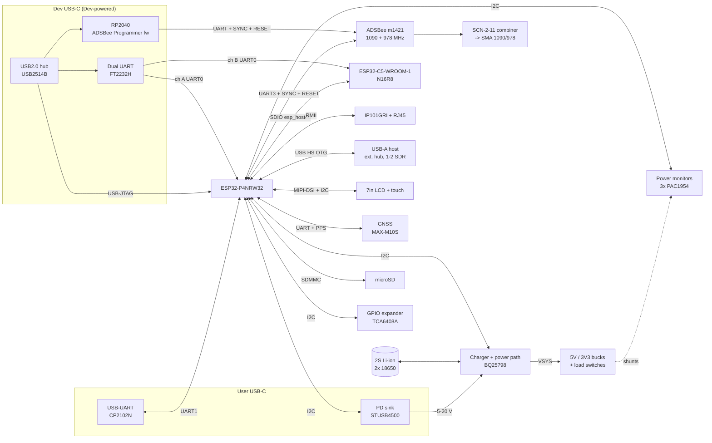

# ADSB_Test — Architecture

Status: **Draft, Rev A**. Part numbers marked _(proposed)_ haven't been
reviewed yet. They were chosen for availability, ESP-IDF support or a vendor
evaluation board, so each circuit can be tried before ADSB_Test exists.

ADS-B reception (1090 MHz Mode S **and** 978 MHz UAT) is done by the **ADSBee
m1421** module, not by SDRs on the P4. The USB-A port is for **one** extra SDR
(AIS or similar), a second if needed, and up to 4 as a nice-to-have, all on an
external hub.

## Block diagram



## Reuse from the reference board

Facts below are from the Waveshare schematic
(`boards/esp32-p4-wifi6-touch-lcd-7b/hardware/vendor/`).

| Block | Reference board | ADSB_Test |
|-------|-----------------|-----------|
| SoC | ESP32-P4NRW32 (32 MB in-package PSRAM) | Same |
| Flash | GD25Q256EYIGR (32 MB) | Same |
| Core supplies | MP1605 / MP1658 bucks, RT9193 LDOs | Same circuit for the P4 core rails (VDD_HP buck etc.) |
| Wireless co-processor | ESP32-C6-MINI-1 over SDIO | **ESP32-C5-WROOM-1-N16R8** (dual-band Wi-Fi 6, 16 MB flash, 8 MB PSRAM, PCB antenna). Same SDIO wiring and esp_hosted host side |
| USB-UART | CH343P | Moves to the Dev port (FT2232H) and User port (CP2102N) |
| Battery | ETA6098 1S charger, RTC battery | Replaced by 2S BQ25798 power path. RTC battery kept if used |
| Display + touch | 7" EK79007 bare COG panel, 2-lane MIPI-DSI, GT911 touch. Panel supplies generated on the board | Same FPC connectors, pin-out and **panel supply circuits** (AVDD 9.6 V boost, VGH/VGL charge pumps, VCOM, 1V8 LDO, AP3032 backlight driver), same stack-up. Touch INT newly wired to the P4 |
| microSD | Yes | Same |
| Audio (ES8311, ES7210, NS4150B) | Yes | **Dropped** |
| CAN (TJA1051), RS485 | Yes | Dropped (not in requirements) |
| CSI camera | Yes | Dropped |
| Ethernet | **None** | New. Test on an RMII PHY breakout |

### ESP32-C5 instead of C6

- **The P4 firmware barely changes.** It talks to the co-processor through
  `esp_wifi_remote` / esp_hosted over the same SDIO bus. Only the slave
  firmware is rebuilt for the C5 target, and the host's slave-target setting
  changes. Check that the esp_hosted release in use supports C5 over SDIO
  (open question Q2a).
- **New on the C5:** 5 GHz Wi-Fi 6. Its pin numbers differ from the C6
  (USB-Serial/JTAG, UART0, strapping pins), so the C5 sheet uses the C5
  datasheet, not a copy of the C6 sheet.
- **Testing before hardware:** the reference board has a C6, so the Wi-Fi
  remote API is tested there. C5-specific behaviour (5 GHz) is tested with an
  ESP32-C5 DevKit running esp_hosted, wired to the reference board. The DevKit
  uses the same N16R8 module.
- **Memory and OTA:** 16 MB flash allows a factory image plus two OTA slots for
  the C5 slave firmware. OTA is a nice-to-have: the P4 can push new C5 firmware
  over SDIO (esp_hosted host-driven slave OTA) or the C5 can be reflashed over
  the Dev port. 8 MB PSRAM gives headroom for larger Wi-Fi buffers.
- **Antenna:** on-module PCB antenna (WROOM-1). Wi-Fi is a backup and the unit
  normally runs offline. The antenna end sits in a board margin outside the
  panel outline (see Mechanical and RF layout). WROOM-1U (u.FL) remains the
  fallback if range turns out too poor.

### ESP32-C5 pins and straps (from the C5 datasheet)

| C5 GPIO | Use | Note |
|---------|-----|------|
| 9 / 10 | SDIO CLK / CMD | to P4 GPIO18 / 19 |
| 8 / 7 / 14 / 13 | SDIO D0 / D1 / D2 / D3 | to P4 GPIO14–17 |
| 11 / 12 | UART0 TX / RX | to Dev FT2232H ch B |
| 28 | BOOT strap (low = download, with 27 high) | FT2232H auto-reset + P4 optional |
| 26 / 27 | Boot-mode straps (27 pulled up internally) | **10 kΩ pull-up on GPIO26**: it floats by default, and 26 = 27 = 28 = 0 selects SDIO download |
| 25, MTDI | SDIO sampling/drive edge straps | defaults unless esp_hosted needs otherwise (check) |
| 7 | JTAG-source strap (= SDIO D1) | ignored with unburned eFuses |

**GPIO13/14 are both SDIO D3/D2 and the C5's USB D−/D+.** With 4-bit SDIO to
the P4, the C5's USB-Serial/JTAG port **can't be used**. So the C5 is flashed and
debugged over **UART0** (Dev FT2232H ch B, DTR/RTS auto-reset on CHIP_PU and
GPIO28), and Dev hub port 2 is spare. Field updates still go over SDIO
(esp_hosted host-driven OTA).

### ESP32-P4 strapping pins (from the P4 datasheet)

- **GPIO35–38:** boot mode. GPIO36 also controls ROM printing.
- **GPIO34:** JTAG source. With unburned eFuses (default) GPIO34 is
  **ignored** and JTAG comes from the USB-Serial/JTAG controller, so the
  P4's GPIO2–5 (an alternative JTAG pad set) are free for GPS/PM. **Never burn
  `EFUSE_JTAG_SEL_ENABLE`** on this board.

## ADSBee m1421 integration

Sources:
- The m1421 module docs (`docs/adsbee-1421/m1421.md`) and firmware README in
  [PantsForBirds/adsbee](https://github.com/PantsForBirds/adsbee).
- The [ADSBee 1421 carrier reference design](https://pantsforbirds.com/the-worlds-smallest-dual-band-ads-b-receiver-module/).
- The official symbol and footprint from
  [PantsForBirds/kicad-libs](https://github.com/PantsForBirds/kicad-libs) (MIT), in [`hardware/kicad/lib`](../hardware/kicad/lib/).

Key facts:
- **Chips:** CC1314R10 + LR2021.
- **Supply:** VCC 1.8–3.3 V (3.3 V here), about 19 mA (< 60 mW). Logic levels are 0–VCC.
- **Console:** UART at 1,000,000 baud by default (9600–3,000,000). The module
  sends `UU` at boot and after every rate change, so a host can autobaud.
- **Output protocols:** Raw, CSBee, MAVLink 1/2, GDL90, Mode S Beast,
  Aircraft JSON. Configured with AT commands and saved to flash.
- **No MLAT:** the module has no per-packet timestamps or RSSI in its
  high-throughput mode.

### SYNC (pad 28): a host-driven input, never an output

| When | SYNC high | SYNC low |
|------|-----------|----------|
| As the CC1314 leaves reset (ROM reads it once) | ROM serial **bootloader** on the console UART (the "backdoor", active high) | Application boots |
| While the application runs | **Sleep request**: the CC1314 enters STANDBY (keeps its aircraft table) and releases the LR2021 bus within ~25 µs | Wake. The CC1314 takes the LR2021 back |

- SYNC has a weak pull-down: an external one on module Rev D and later, an
  internal one before that. A floating SYNC keeps the module awake.
- **Any reset with SYNC high enters the bootloader**, including a watchdog
  reset. Before long host-driven sleeps, send `AT+WATCHDOG=0`.
- The official KiCad symbol types SYNC as an "output". **Our copy corrects it
  to "input".**

There's no "start of message" output. The closest things are the activity LED
outputs **SD26 (pad 15, 1090 MHz)** and **SD27 (pad 16, 978 MHz UAT)**. Both go
to LEDs and to the LA header (CH7, CH11), and they're good enough as rough
message-activity markers.

### Pad connections

| m1421 pad(s) | Signal | ADSB_Test connection |
|--------------|--------|----------------------|
| 1, 4, 19, 22 | VCC | `3V3_M1421`: switched branch, PM3 ch2 |
| 6, 18, 23, 25, 27, 34, 36, MP | GND | GND. **Filled and capped** thermal vias in both MP pads and under the GND pads next to the RF pins |
| 20 / 21 | SURX / SUTX (console) | P4 UART3 at 1 Mbaud (≥ 921600 recommended). TX also goes to the Dev probe. RX comes from a 2:1 mux (74LVC1G157): P4 by default, Dev probe when selected |
| 28 | SYNC | `SYNC = P4_SYNC OR DEV_SYNC` (74LVC1G32, target-powered). DEV_SYNC is pulled low, so an unpowered Dev domain can't assert it. 100 kΩ pull-down on SYNC. LA CH6 |
| 17 | ~SRST | Open-drain wired-AND: TCA6408A bit 7, Dev probe (74LVC1G07, Ioff), 10-pin JTAG header pin 10 |
| 8–11 | JMSC / JCKC / JTDO / JTDI | 10-pin 1.27 mm Cortex debug header, as on the carrier: **Segger J-Link, target CC1314R10, JTAG 4 MHz** (the documented flow) |
| 15 / 16 | SD26 / SD27 | 1090 / UAT activity LEDs (red / green, as carrier) + LA CH7 / CH11 |
| 12–14 | SD23–25 | Test pads |
| 24 / 26 | SRF (978) / LRFL (1090) | SCN-2-11+ combiner (100 Ω across ports) → ESD7351 → SMA. Copy the carrier's RF layout. Keep the footprint's top-copper keep-outs |
| 2, 3, 5, 7, 29–33 | LR2021 DIO / reset / SPI / BUSY | Test pads only (normal use: not connected). Leaves room for an optional LR2021 hand-off later |
| 35 | LRFH (LR2021 2.4 GHz) | Not connected (test pad). Possible LoRa/mesh use later, but the module has no transmitter certification |

### Firmware updates and Dev-port access

The m1421 is normally updated over **its own console UART** through the
CC1314 ROM bootloader. No debugger is needed. The sequence:
1. Hold SYNC high.
2. Pulse ~SRST.
3. Autobaud with `0x55 0x55` (≤ 1.2 Mbaud).
4. Erase, program and verify.
5. Drive SYNC low, then reset.

That gives two update paths on ADSB_Test:

| Path | How | Use |
|------|-----|-----|
| **P4 (field update)** | The P4 drives SYNC (GPIO) and ~SRST (expander) and talks to the ROM bootloader on UART3. It needs a CC13x4 ROM bootloader client in the BSP. Write it from TI's protocol spec (CC13x4 TRM SWCU194, "ROM Serial Bootloader") to keep the BSP MIT. The ADSBee Programmer's client is GPL-3.0 | Firmware updates in the field, including over Wi-Fi/Ethernet via the P4 |
| **Dev USB-C (bench)** | RP2040 on Dev hub port 4 running the **stock ADSBee 1421 Programmer** firmware (open source, RP2040-Zero). Any changes go in a separate fork repo that links back to PantsForBirds/adsbee (Q16). It works as a USB-serial adapter with RTS → SYNC and DTR → ~SRST, so the ADSBee web console's firmware uploader and AT terminal work unchanged. It also drives the UART mux select while its port is open | Console, AT configuration, firmware upload, logs from the PC |
| **JTAG** | 10-pin Cortex header + Segger J-Link | Breakpoint debugging, and recovery if the bootloader backdoor was turned off (`AT+BOOTLOADER_PIN=0`) |

Living with the stock Programmer (Q16):
- At every power-up (that is, every time the Dev cable is plugged in) it
  resets the module into the bootloader, CRC-checks it against its baked-in
  image, reflashes any sectors that differ, then restarts the app. Reception
  stops for a moment.
- **Rule:** keep the Programmer's baked image the same as the m1421 firmware
  release in use. Update both together: re-flash the RP2040 `.uf2` from the same
  `adsbee_1421-<version>` release. A P4 field update to a newer version is
  reverted the next time the Dev cable is plugged in, unless the Programmer is
  updated too.
- **Hardware escape hatch:** 0 Ω links (fitted) in the RP2040 → DEV_SYNC and
  RP2040 → ~SRST paths. Removing them makes the Dev port a console-only UART
  that can't reset or reflash the module.

JTAG over the Dev USB port isn't provided. The CC1314 is flashed and debugged
with a J-Link (cJTAG/JTAG), and no documented RP2040/FTDI flow exists for it.
The UART bootloader covers everything except backdoor-off recovery and
breakpoint debugging.

## Power budget and battery

Target: **everything running for about 1 hour on battery** (PWR-02).

| Load | Typical (W) | Max (W) | Notes |
|------|-------------|---------|-------|
| ESP32-P4 + flash + PSRAM | 0.5 | 0.8 | |
| ESP32-C5 (Wi-Fi active) | 0.4 | 1.0 | TX peaks |
| 7" LCD + backlight | 2.0 | 3.0 | Backlight dominant. PWM-dimmable |
| Ethernet PHY | 0.3 | 0.4 | Switchable |
| GPS + active antenna | 0.1 | 0.15 | |
| ADSBee m1421 | 0.06 | 0.1 | |
| SDR #1 (AIS, RTL-SDR class) | 1.4 | 1.5 | |
| SDR #2 (optional) | — | 1.5 | |
| External hub | 0.2 | 0.5 | Bus-powered |
| Misc (PD, monitors, LEDs, microSD) | 0.2 | 0.5 | |
| **Subtotal** | **5.2** | **9.4** | |
| Conversion losses (~12 %) | 0.6 | 1.1 | |
| **Total from battery** | **≈ 5.8 W** | **≈ 10.5 W** | |

Battery: **2S1P Li-ion 18650, ≥ 3000 mAh cells** _(proposed)_, giving about
21.6 Wh nominal. Allowing 80 % usable capacity and 10 % ageing:

| Case | Runtime |
|------|---------|
| Typical (1 SDR) | ≈ 2.7 h |
| Worst case (2 SDRs, full backlight) | ≈ 1.5 h |

Both meet the 1 h target with margin. If 4 SDRs are ever run from battery
(+3 W), use **2S2P** (≈ 43 Wh).

Charging while running at the worst case needs about 10.5 W + 2 A × 8.4 V ≈
28 W at the input. So the PD sink requests **15 V / 3 A** first, and
firmware sets the BQ25798 input-current limit from the negotiated contract.
At 9 V the charge current is reduced automatically. At 5 V the board runs
but charges slowly.

## Power tree

```
User USB-C ──► STUSB4500 (PD sink: 15 V pref, 9 V, 5 V fallback)
                   │ VBUS_USER  [PM1 ch1]
                   ▼
              BQ25798 buck-boost charger, power path ◄──► 2S Li-ion + NTC  [PM1 ch2 VBAT, bidirectional]
                   │ VSYS 6.0–8.4 V  [PM1 ch3]
     ┌─────────────┴─────────────┐
     ▼                           ▼
  5V buck 3 A                 3V3 buck 3 A (TPS62933)
     ├► USB-A eFuse 1.5 A (TPS25200) [PM1 ch4 5V_SDR]
     └► LCD + backlight (switch)     [PM2 ch1 5V_LCD]
                                 ├► 3V3_P4     [PM2 ch2]  (+ reference-board core buck/LDOs)
                                 ├► 3V3_C5     [PM2 ch3]
                                 ├► 3V3_ETH    [PM2 ch4]  (switch)
                                 ├► 3V3_GPS    [PM3 ch1]  (switch)
                                 ├► 3V3_M1421  [PM3 ch2]  (switch)
                                 └► 3V3_PERIPH [PM3 ch3]  (touch, microSD, PD, monitors, expander)

Dev USB-C VBUS ──► LDO 3V3_DEV ──► USB2514B hub + FT2232H + RP2040 (ADSBee Programmer fw)  (separate domain)
```

The USB-A eFuse limit drops to 1.5 A (1–2 SDRs + hub). Use a powered hub for
4 SDRs. The 5 V buck drops to 3 A.

## Power-monitor channel map _(proposed: 3 × PAC1954, 12 channels)_

| Device (I2C addr TBC) | Ch1 | Ch2 | Ch3 | Ch4 |
|-----------------------|-----|-----|-----|-----|
| PM1 — input/battery | VBUS_USER | VBAT (bidirectional) | VSYS | 5V_SDR (USB-A) |
| PM2 — main loads | 5V_LCD | 3V3_P4 | 3V3_C5 | 3V3_ETH |
| PM3 — peripherals | 3V3_GPS | 3V3_M1421 | 3V3_PERIPH | spare (5V rail total) |

The BQ25798's built-in ADC also reports VBUS/VBAT/IBAT/IBUS, which gives a
second, independent measurement for checking.

## USB topology

| Port | Connector | Connected to |
|------|-----------|--------------|
| User | USB-C (sink) | CC → STUSB4500. D+/D- → CP2102N → P4 UART1 |
| Dev | USB-C (device) | USB2514B hub. Port 1: P4 USB-Serial/JTAG. Port 2: spare (the C5's USB pins are used by SDIO). Port 3: FT2232H (A = P4 UART0 + auto-reset, B = C5 UART0 + auto-reset). Port 4: RP2040 running the ADSBee 1421 Programmer firmware, auto-reflash off (m1421 console + RTS→SYNC / DTR→~SRST + UART mux select) |
| Host | USB-A | P4 USB 2.0 HS OTG (host) → TPS25200 eFuse, ESD → external hub → SDR(s) |

Design rules for the Dev domain:
- The hub, FT2232H and RP2040 run from Dev VBUS, so debugging still works when
  the target is unpowered.
- Every signal crossing into the target goes through a buffer powered from the
  target rail (e.g. SN74LVC2T45), or uses open-drain, so the Dev domain can't
  back-power the target (USB-04).
- The P4 USB-Serial/JTAG lines get series resistors and ESD protection
  only.
- The BQ25798's BC1.2 detection is **disabled**, because the User D+/D- lines
  go to the CP2102N.

## Test points and logic-analyser header

- Every power rail gets a test point (and a 0 Ω link for staged bring-up).
- Every PAC1954 shunt gets Kelvin test pads.
- Key digital signals go to **one 2×20 2.54 mm keyed box header** that the
  **Kingst LA5016** 40-way cable plugs straight into. The LA5016 uses only the
  row on the key side: CH0–7, GND, CH8–15, GND, PWM1, PWM2. The other row is
  NC on the LA5016 apart from 2 GND. It's reserved for the LA5032
  (CH16–31) as a future upgrade.
- **PWM1 / PWM2** are outputs from the analyser. They go to test pads, and
  PWM1 can be linked by a DNP 0 Ω to the GPS PPS net to simulate PPS without a
  GPS fix.
- Each signal is tapped through a 0 Ω/100 Ω series resistor at the header.
  That keeps stubs short and lets a misbehaving channel be cut.

Header pin-out. The signal row is the key-side row, using the odd pins. Check
pin 1 against the cable's triangle mark before layout.

| Pin | LA5016 | Pin | LA5016 (row 2) |
|-----|--------|-----|----------------|
| 1–15 (odd) | CH0–CH7 | 2–16 (even) | NC (LA5032 reserved) |
| 17 | GND | 18 | GND |
| 19–33 (odd) | CH8–CH15 | 20–34 (even) | NC (LA5032 reserved) |
| 35 | GND | 36 | GND |
| 37 | PWM1 (LA output) | 38 | NC |
| 39 | PWM2 (LA output) | 40 | NC |

Signal assignment:

| LA ch | Signal | LA ch | Signal |
|-------|--------|-------|--------|
| 0 | I2C SCL | 8 | P4 UART0 TX (console) |
| 1 | I2C SDA | 9 | C5 UART0 TX |
| 2 | GPS PPS | 10 | User UART TX (P4 → CP2102N) |
| 3 | GPS TX → P4 | 11 | m1421 SD27 (UAT activity) |
| 4 | m1421 UART TX | 12 | PM ALERT (wired-OR) |
| 5 | m1421 UART RX (after mux) | 13 | Charger INT / PD ALERT |
| 6 | m1421 SYNC | 14 | P4 debug GPIO A (firmware timing marker) |
| 7 | m1421 SD26 (1090 activity) | 15 | P4 debug GPIO B (firmware timing marker) |

## ESP32-P4 pin allocation

The source of truth is [`bsp/include/bsp/board_pins.h`](../bsp/include/bsp/board_pins.h).
- **Reused pins** come from the Waveshare schematic and are identical to the
  reference board.
- **New pins** use GPIOs freed by dropping audio, CAN, RS485 and the battery
  ADC. They follow the ESP32-P4 EMAC IOMUX table and the ESP-IDF Ethernet
  defaults (`esp_eth_mac_esp.h`; `examples/ethernet/basic`: MDC 31, MDIO 52,
  PHY_RST 51).
- MIPI-DSI, USB HS and the flash use dedicated pins and aren't listed.

| GPIO | ADSB_Test | Reference board | Ref header |
|------|-----------|-----------------|------------|
| 0, 1 | 32.768 kHz crystal | same | |
| 2 / 3 | GPS UART2 TX / RX | free | P3 |
| 4 | GPS PPS | free | P3 |
| 5 | PM ALERT (PAC1954, wired-OR) | free | P3 |
| 6 | C5 GPIO (ref: C6 IO2) | same | |
| 7 / 8 | I2C SDA / SCL | same | |
| 9 | Charger INT + PD ALERT (wired-OR) | I2S DOUT | |
| 10 / 11 | DBG_A / DBG_B (LA CH14/15) | I2S LRCK / DIN | |
| 12, 13 | spare | I2S SCLK / MCLK | |
| 14–17 | SDIO D0–D3 to C5 | same (C6) | |
| 18 / 19 | SDIO CLK / CMD to C5 | same (C6) | |
| 20 | spare (ADC) | battery sense | |
| 21 / 22 | User UART1 TX / RX (CP2102N) | CAN RX / TX | |
| 23 | Touch reset | same | |
| 24 / 25 | USB-Serial/JTAG → Dev hub | USB-C H2 | |
| 26 | Touch INT | RS485 TX | |
| 27 | USB-A eFuse FAULT | RS485 RX | |
| 28 / 29 / 30 | RMII CRS_DV / RXD0 / RXD1 | free | P3 |
| 31 | MDC | free | P3 |
| 32 | Backlight PWM | same | |
| 33 | LCD reset | same | |
| 34 | RMII TXD0 | free | P3 |
| 35 | **BOOT strap + RMII TXD1** | BOOT strap | (BOOT button) |
| 36 | spare (strap, keep unloaded) | free | P3 |
| 37 / 38 | UART0 TX / RX → Dev FT2232H A | → CH343P | |
| 39–42 | microSD D0–D3 | same | |
| 43 / 44 | microSD CLK / CMD | same | |
| 45 | microSD power enable (low = on) | same | |
| 46 / 47 | m1421 UART3 TX / RX | free | P1 |
| 48 | m1421 SYNC | free | P1 |
| 49 | RMII TX_EN | free | P1 |
| 50 | RMII REF_CLK in (50 MHz) | free | P1 |
| 51 | PHY reset | free | P1 |
| 52 | MDIO | free | P1 |
| 53 | Expander INT | PA_CTRL | |
| 54 | C5 CHIP_PU (reset) | same (C6) | |

**51 of 55 GPIOs used. Spare: 12, 13, 20, 36.** Slow outputs are on the
TCA6408A: EN_LCD, EN_ETH, EN_GPS, EN_M1421, USBA_EN, GPS_RST, M1421_RESET,
and one spare bit.

**Phase 1 bonus:** GPS (2, 3, 4), PM ALERT (5), m1421 (46, 47, 48) and
Ethernet (28–31, 34, 49–52) are all on the reference board's P1/P3 headers.
Eval boards wired to the reference board therefore use **the same GPIOs as
ADSB_Test**. The exceptions are RMII TXD1 (GPIO35, only on the BOOT button
pad) and charger/PD INT (GPIO9, used by the codec on the reference board).
For those, use a spare header pin in Phase 1.

**Checks:**
- **GPIO35** is both the BOOT strap and RMII TXD1, as on Espressif's P4 EV
  board. The PHY's TXD1 input must not pull it low during reset (check the
  IP101GRI pin state at reset). Keep the reference 4.7 kΩ pull-up.
- P4 strapping pins confirmed from the datasheet: GPIO34–38 (see above).
  GPIO36 is left unloaded on purpose.

## Mechanical and RF layout

Decided 2026-10-10 (Q8, Q10):
- **Board outline:** about the size of the 7" panel, slightly larger so the
  connectors reach through the case wall.
- **Panel mounting:** the panel mounts on the PCB, as the reference board does
  (stand-offs/adhesive frame on the top side, FPC to the display connector).
- **Connector edges:** digital/power connectors (User USB-C, Dev USB-C, USB-A,
  RJ45, microSD) go on one edge. The two RF SMA connectors (GNSS and m1421
  1090/978) go on the **opposite** edge, so RF and digital cables don't share a
  side.
- **Inside the case:** the LA5016 header and the 10-pin m1421 JTAG header
  don't need to reach the case wall, but stay reachable with the back cover
  off.

Outline and case (Q20, decided 2026-10-10):

| Item | Decision |
|------|----------|
| Board outline | Panel area 164 × 97 mm plus a **≈ 12 mm margin on each short edge**, so ≈ **188 × 97 mm** (final widths set during layout) |
| Digital edge (one short edge) | User USB-C, Dev USB-C, USB-A, RJ45, microSD (mid-mount/sink-in parts, ≈ 70 mm of the 97 mm edge) |
| RF edge (other short edge) | GNSS SMA and m1421 SMA, spaced apart |
| C5 antenna | In the digital-edge margin, at the end **furthest from the RJ45 and USB-A metal shells** |
| Case | **3D-printed plastic** for the prototypes (RF-friendly for the on-module Wi-Fi antenna). ≈ 2 mm walls on the **short edges** so the connectors reach through. **Thicker walls (≈ 3 mm, optionally ribbed) on the long edges** for stiffness, since nothing passes through them |
| Battery | 2 × 18650 (2S1P) in the case behind the board. Expected overall depth ≈ 33–35 mm. A 2S flat pouch pack (≈ 22–25 mm total) is a later option needing no PCB change |

Consequences:

| Topic | Rule |
|-------|------|
| Component side | The panel is bonded to the top side (≈ 1.4 mm tape gap), so **all components go on the bottom side**. See the panel stack-up below |
| Board zoning | RF zone (m1421 + combiner + SMA, GNSS + bias-T + SMA) along the RF edge. Digital zone (P4, PSRAM/flash, MIPI-DSI, USB, Ethernet) and power zone (bucks, charger) away from it. Continuous ground plane, stitched along the zone boundary |
| RF cans _(optional)_ | Two-piece shield footprints (frame soldered, lid removable for probing) over: (1) m1421 + SCN-2-11 combiner + ESD; (2) GNSS module + bias-T; (3, optional) the switching regulators, as a noise source. Fit the frames, decide on lids after the first RF tests. Clear the m1421's 2.7 mm height and the footprint's top-copper keep-outs |
| RF feeds | 50 Ω CPW from each module to its edge SMA, as short as possible, ground-via fenced. m1421 RF routing copied from the ADSBee 1421 carrier |
| C5 antenna | **On-module PCB antenna (ESP32-C5-WROOM-1-N16R8)**: Wi-Fi is a backup and the unit normally runs offline (Q18). Place the module's antenna end in a **board margin strip outside the panel outline**, at the board edge, with the datasheet copper keep-out on all layers. Keep it away from the SMA/RF edge and the metal panel frame. The case must be non-metallic over the antenna. Expect reduced range, which is acceptable for a backup link |
| Noise | MIPI-DSI and the bucks are the main digital noise sources near the 1090/978 and GNSS L1 inputs. Keep the switch-node copper small. The buck frequencies must not have harmonics landing on 978/1090/1575 MHz (check during part selection) |

### 7" panel: what we know (Q19)

There's no public datasheet for the bare panel. Panels with the EK79007 driver
vary by vendor in outline (about 164 × 97 mm up to 170 × 103 mm) and in lane
count. So **the authoritative source is Waveshare's own dimension drawing and
STEP model** of the ESP32-P4-WIFI6-Touch-LCD-7B (resources page →
"Drawing (3D ZIP)", 2025-11-08). The files are kept locally in
`boards/esp32-p4-wifi6-touch-lcd-7b/hardware/vendor/` (git-ignored).

| Item | Value | Source |
|------|-------|--------|
| Cover lens outline | 164.28 ± 0.1 × 99.17 ± 0.1 mm | Waveshare drawing |
| Viewing area | 154.58 × 86.42 mm (offsets from lens edge: 3.06 left, 6.64 right, 4.02 top) | Waveshare drawing |
| LCD module outline | 164 × 97.1 mm | Waveshare drawing |
| Lens front → LCD back | 5.7 mm | Waveshare drawing |
| LCD back → PCB top face | **≈ 1.4 mm** (scaled from the drawing; looks like a bonding tape/foam layer, no stand-offs) | Waveshare drawing, measured |
| Waveshare PCB | 164 × 97 × 1.6 mm, PCB edge 1.58 mm in from the lens bottom edge | Waveshare drawing |
| Overall depth (lens front → tallest back-side part) | 15.3 mm, so about **6.6 mm** component height behind the PCB | Waveshare drawing |
| Mounting | 4 × M2.5 threaded holes, **156 × 89 mm** pitch (4 mm in from the PCB edges) | Waveshare drawing |
| Driver IC / interface | EK79007, **2-lane MIPI-DSI**, 1024 × 600, RGB888/565. ESP-IDF component `esp_lcd_ek79007` | Waveshare `07_color_panel` example |
| DSI PHY supply | P4 internal LDO channel 3 at 2.5 V | Waveshare example |
| Touch | GT911 (I2C) | Waveshare examples |
| LCD reset | GPIO33 in the vendor example (check against the schematic before it goes into `board_pins.h`) | Waveshare example |

**Stack-up for ADSB_Test ("as short as we can get away with"):** copy the
Waveshare stack.
- The panel is bonded straight to the **top side of the PCB** with the same
  ≈ 1.4 mm tape layer. No stand-offs.
- The top side under the panel is **component-free**: only flat items such as
  test pads, fiducials and the panel FPC exit.
- All components go on the **bottom side** (single-sided assembly).
- The case depth is set by the tallest bottom-side part. Waveshare manages 6.6
  mm. Ethernet and USB-A make that hard, so use **mid-mount / sink-in RJ45 and
  USB-A** through cut-outs in the board margin, and edge-straddle SMAs.
- The 2S 18650 pack (18.6 mm diameter) goes in the case behind the board, off
  the PCB.
- **Board outline:** the 164 × 97 mm panel area plus margin strips on the
  connector edges (width TBC, to suit the case wall and the C5 antenna). The
  4 × M2.5 holes stay on the Waveshare 156 × 89 mm pitch.

## Risks to test early

| Risk | Why | Early test |
|------|-----|------------|
| AIS SDR decode load on the P4 | DDC + AIS demod of one 1.6–2.4 MS/s stream | Profile on the reference board with 1 RTL-SDR |
| esp_hosted with C5 over SDIO | Newer slave target | C5 DevKit + reference board |
| m1421 Dev-port and P4 update paths | Programmer firmware must run with auto-reflash off; the P4 needs a ROM bootloader client | Dev Kit: run the Programmer in pass-through, then flash the module from the reference board's P4 over UART |
| SYNC held high during a reset | Module boots into the bootloader instead of the app | P4 drives SYNC low before any reset. `AT+WATCHDOG=0` for long sleeps |
| RF: 1090/978 MHz vs GPS L1 vs Wi-Fi 2.4/5 GHz on one board | Desense | Keep the carrier's RF layout. Separate antennas, shielding/keep-outs |
| USB-A current | 1–2 SDRs + hub ≈ 0.5–0.8 A | Measure, set the eFuse limit |

## Proposed parts (to review)

| Function | Proposed | Alternatives | Reason |
|----------|----------|--------------|--------|
| ADS-B receiver | ADSBee m1421 | — | User choice. Dual-band, < 60 mW, UART |
| ADS-B RF combiner | MiniCircuits SCN-2-11+ | — | As on the ADSBee 1421 carrier |
| Co-processor | ESP32-C5-WROOM-1-N16R8 | WROOM-1U-N16R8 (u.FL) if range is poor | Dual-band, esp_hosted, room for OTA. Wi-Fi is a backup. Antenna in a board margin outside the panel |
| PD sink | STUSB4500 | AP33772S, CH224K | Standalone (NVM), I2C status |
| Charger | BQ25798 | BQ25792 (TI pages 404 since 2026-10-10), MP2762A | 1–4 cell buck-boost, power path, ADC, MPPT. Same family as BQ25792: check pin compatibility (Q21) |
| Battery | 2S1P 18650 ≥ 3000 mAh, protected | 2S2P | ≈ 21.6 Wh, 1.5–2.7 h |
| Power monitor | PAC1954 | INA3221 | 4 ch + energy accumulators |
| 3V3 buck | TPS62933 | TPS62130 | 3.8–30 V in, 3 A |
| 5V buck | TBC (3 A, 6–8.4 V in) | | |
| USB-A power | TPS25200 eFuse | TPS2553 | Adjustable limit, fault flag |
| Ethernet PHY | IP101GRI | LAN8720A | Espressif P4 EV board, ESP-IDF driver |
| Dev hub | USB2514B | CH334 | 4-port HS hub |
| Dev UART | FT2232H | CH342 | 2 × UART with DTR/RTS auto-reset |
| Dev m1421 access | RP2040 + ADSBee 1421 Programmer firmware (auto-reflash off) | FTDI channel with RTS→SYNC, DTR→~SRST | Same as the Dev Kit, works with the ADSBee web console |
| m1421 JTAG | 10-pin 1.27 mm Cortex header + Segger J-Link | — | Documented CC1314R10 flow |
| User UART | CP2102N | CH343P (reference) | |
| GNSS | u-blox MAX-M10S | NEO-M9N | Low power, time pulse |
| GPIO expander | TCA6408A | TCA9535 | I2C, INT output |
