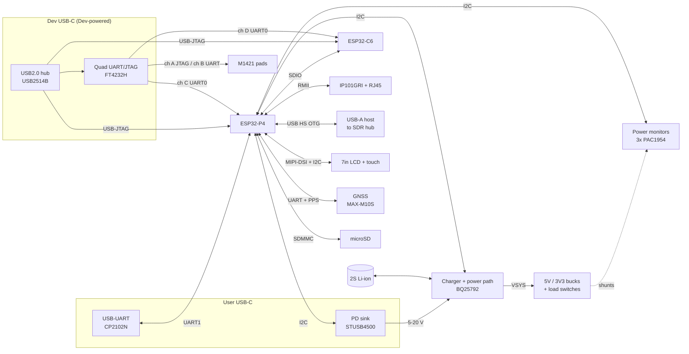

# ADSB_Test — Architecture

Status: **Draft, Rev A**. Part numbers marked _(proposed)_ haven't been
reviewed yet. They are starting points chosen for availability, ESP-IDF
support or a vendor evaluation board, so the circuit can be tried on the
reference board first.

## Block diagram



## Reuse from the reference board

| Block | Approach |
|-------|----------|
| ESP32-P4 core, flash, PSRAM, crystal, boot/reset | Copy the reference circuit unchanged |
| ESP32-C6 + SDIO link + antenna | Copy unchanged. The same esp_hosted firmware runs on both boards |
| LCD + touch connector, backlight | Same connector and pin-out, so the same panel plugs into both boards |
| microSD | Copy unchanged |
| Audio | Not required. Dropped unless wanted (see open questions) |

## Power tree

```
User USB-C ──► STUSB4500 (PD sink: 15 V pref, 9 V, 5 V fallback)
                   │ VBUS_USER  [PM ch]
                   ▼
              BQ25792 buck-boost charger, power path ◄──► 2S Li-ion pack + NTC  [PM ch VBAT, bidirectional]
                   │ VSYS 6.0–8.4 V  [PM ch]
     ┌─────────────┼───────────────────────────┐
     ▼             ▼                           ▼
  5V buck 4 A   3V3 buck 3 A (TPS62933)     M1421 supply (TBC)  [PM ch]
     │             │
     ├► USB-A eFuse 2.5 A (TPS25200) [PM ch 5V_SDR]
     └► LCD + backlight [PM ch 5V_LCD]
                   ├► 3V3_P4   (P4, flash; P4 internal LDOs)  [PM ch]
                   ├► 3V3_C6   [PM ch]
                   ├► 3V3_ETH  [PM ch]
                   ├► 3V3_GPS  [PM ch]
                   └► 3V3_PERIPH (touch, microSD, PD, monitors) [PM ch]

Dev USB-C VBUS ──► LDO 3V3_DEV ──► USB2514B hub + FT4232H  (separate domain, not monitored)
```

Each 3V3 branch has its own shunt resistor (and, where useful, a load switch).
That's what lets every load be measured separately (PWR-03).

## Power-monitor channel map _(proposed: 3 × PAC1954, 12 channels)_

| Device (I2C addr TBC) | Ch1 | Ch2 | Ch3 | Ch4 |
|-----------------------|-----|-----|-----|-----|
| PM1 — input/battery | VBUS_USER | VBAT (bidirectional) | VSYS | 5V_SDR (USB-A) |
| PM2 — main loads | 5V_LCD | 3V3_P4 | 3V3_C6 | 3V3_ETH |
| PM3 — peripherals | 3V3_GPS | M1421 | 3V3_PERIPH | spare |

The BQ25792's built-in ADC also reports VBUS/VBAT/IBAT/IBUS, which gives a
second, independent measurement for checking.

## USB topology

| Port | Connector | Connected to |
|------|-----------|--------------|
| User | USB-C (receptacle, sink) | CC → STUSB4500. D+/D- → CP2102N → P4 UART1 |
| Dev | USB-C (receptacle, device) | USB2514B hub. Port 1: P4 USB-Serial/JTAG (FS). Port 2: C6 USB-Serial/JTAG (GPIO12/13). Port 3: FT4232H. Port 4: spare / M1421 USB if it has one |
| Host | USB-A | P4 USB 2.0 HS OTG (host mode) through a TPS25200 eFuse and ESD protection |

FT4232H channel use:
- **A:** JTAG (MPSSE) to the M1421
- **B:** M1421 debug UART
- **C:** P4 UART0 console, with DTR/RTS auto-reset into download mode
- **D:** C6 UART0, with DTR/RTS auto-reset

Design rules for the Dev domain:
- The hub and FT4232H run from Dev VBUS, so debugging still works when the
  target is unpowered.
- Every signal crossing into the target goes through a buffer powered from the
  target rail (e.g. SN74LVC2T45), or uses open-drain and series resistors, so
  the Dev domain can't back-power the target (USB-04).
- The P4 and C6 USB-Serial/JTAG signals are driven by the chips themselves, so
  they need no buffer. Use series resistors and ESD protection only.

The BQ25792's own BC1.2 detection must be **disabled**, because the User D+/D-
lines go to the CP2102N, and PD negotiation is done by the STUSB4500.

## ESP32-P4 GPIO budget (estimate)

The ESP32-P4 has 55 GPIOs. MIPI-DSI and USB HS use dedicated pins and are
not counted here.

| Function | Pins |
|----------|------|
| SDIO to C6 (CLK, CMD, D0–D3) + C6 EN + C6 BOOT | 8 |
| microSD (SDMMC slot 0) | 6 |
| Ethernet RMII (TXD0/1, TX_EN, RXD0/1, CRS_DV, REF_CLK, MDC, MDIO) + PHY reset | 10 |
| I2C (shared: touch, PD, charger, 3 × PAC1954) | 2 |
| Interrupts: touch INT, charger INT, PD ALERT, PM ALERT (wired-OR) | 4 |
| Touch reset, LCD reset, backlight PWM | 3 |
| GPS UART + PPS + reset | 4 |
| UART0 console (to FT4232H ch C) | 2 |
| UART1 user (to CP2102N) | 2 |
| USB-A eFuse enable + fault | 2 |
| Load-switch enables (LCD, ETH, GPS, M1421) | 4 |
| M1421 control/data link (TBC, e.g. UART or SPI) | 4 |
| BOOT strap button | 1 |
| **Total** | **≈ 52 of 55** |

The budget is tight. If pins run out, move the load-switch enables, resets and
LED to a small I2C GPIO expander (e.g. TCA6408A) on the shared I2C bus.

## Risks to test early on the reference board

| Risk | Why | Early test |
|------|-----|------------|
| 4 × SDR throughput on the P4 USB host | 4 × RTL-SDR at 2.4 MS/s (8-bit IQ) ≈ 19 MB/s through one HS hub | Connect 1, then 2, then 4 RTL-SDRs to the reference board through a hub and measure sustained bulk throughput |
| CPU load for 4 ADS-B decoders | dump1090-style demodulation is CPU-heavy and the P4 has no SIMD comparable to NEON | Port a decoder and profile one stream on the reference board before committing to 4 |
| USB-A current | 4 × RTL-SDR ≈ 1.2–1.5 A + hub. From battery this is ~6–8 W | Measure with a USB power meter. Set the eFuse limit from the result |
| GPIO budget | ≈ 52/55 used | Freeze the pin map early in `board_pins.h` |
| C6 EN/BOOT driven from both P4 and FT4232H | Contention | Open-drain from both sides |

## Proposed parts (to review)

| Function | Proposed | Alternatives | Reason |
|----------|----------|--------------|--------|
| PD sink | STUSB4500 | AP33772S, CH224K | Standalone (NVM), I2C status, eval board available |
| Charger | BQ25792 | BQ25895 (1S only), MP2762A | 1–4 cell buck-boost, power path, built-in ADC, OTG 5 V |
| Power monitor | PAC1954 | INA3221, INA226 (1 ch each) | 4 ch with energy accumulators, 0–32 V |
| 3V3 buck | TPS62933 | TPS62130 | 3.8–30 V input, 3 A |
| 5V buck | TBC (≥ 4 A, 6–8.4 V input) | | Must stay in regulation down to the 2S cut-off |
| USB-A power | TPS25200 eFuse | TPS2553 | Adjustable limit, fault flag |
| Ethernet PHY | IP101GRI | LAN8720A | Used on Espressif's ESP32-P4 Function EV board; ESP-IDF driver |
| Dev hub | USB2514B | CH334 | 4-port HS hub, well proven |
| Dev bridge | FT4232H | CH347 + CH342 | 2 × MPSSE (JTAG) + 2 × UART, OpenOCD support |
| User bridge | CP2102N | CH340 | ESP-IDF boards commonly use it |
| GNSS | u-blox MAX-M10S | NEO-M9N | Low power, UART, time pulse |
