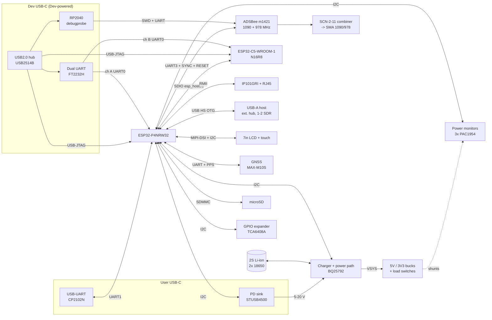

# ADSB_Test — Architecture

Status: **Draft, Rev A**. Part numbers marked _(proposed)_ haven't been
reviewed yet. They were chosen for availability, ESP-IDF support or a vendor
evaluation board, so each circuit can be tried before ADSB_Test exists.

ADS-B reception (1090 MHz Mode S **and** 978 MHz UAT) is done by the **ADSBee
m1421** module, not by SDRs on the P4. The USB-A port is for **one** extra SDR
(AIS or similar), a second if needed, and up to 4 as a nice-to-have, all on an
external hub.

## Block diagram



## Reuse from the reference board

Facts below are from the Waveshare schematic
(`boards/esp32-p4-wifi6-touch-lcd-7b/hardware/vendor/`).

| Block | Reference board | ADSB_Test |
|-------|-----------------|-----------|
| SoC | ESP32-P4NRW32 (32 MB in-package PSRAM) | Same |
| Flash | GD25Q256EYIGR (32 MB) | Same |
| Core supplies | MP1605 / MP1658 bucks, RT9193 LDOs | Same circuit for the P4 core rails (VDD_HP buck etc.) |
| Wireless co-processor | ESP32-C6-MINI-1 over SDIO | **ESP32-C5-WROOM-1-N16R8** (dual-band Wi-Fi 6, 16 MB flash, 8 MB PSRAM). Same SDIO wiring and esp_hosted host side |
| USB-UART | CH343P | Moves to the Dev port (FT2232H) and User port (CP2102N) |
| Battery | ETA6098 1S charger, RTC battery | Replaced by 2S BQ25792 power path. RTC battery kept if used |
| Display + touch | 7" MIPI-DSI connector | Same connector and pin-out |
| microSD | Yes | Same |
| Audio (ES8311, ES7210, NS4150B) | Yes | **Dropped** |
| CAN (TJA1051), RS485 | Yes | Dropped (not in requirements) |
| CSI camera | Yes | Dropped |
| Ethernet | **None** | New. Test on an RMII PHY breakout |

### ESP32-C5 instead of C6

- **The P4 firmware barely changes.** It talks to the co-processor through
  `esp_wifi_remote` / esp_hosted over the same SDIO bus. Only the slave
  firmware is rebuilt for the C5 target, and the host's slave-target setting
  changes. Check that the esp_hosted release in use supports C5 over SDIO
  (open question Q2a).
- **New on the C5:** 5 GHz Wi-Fi 6. Its pin numbers differ from the C6
  (USB-Serial/JTAG, UART0, strapping pins), so the C5 sheet uses the C5
  datasheet, not a copy of the C6 sheet.
- **Testing before hardware:** the reference board has a C6, so the Wi-Fi
  remote API is tested there. C5-specific behaviour (5 GHz) is tested with an
  ESP32-C5 DevKit running esp_hosted, wired to the reference board. The DevKit
  uses the same N16R8 module.
- **Memory and OTA:** 16 MB flash allows a factory image plus two OTA slots for
  the C5 slave firmware. OTA is a nice-to-have: the P4 can push new C5 firmware
  over SDIO (esp_hosted host-driven slave OTA) or the C5 can be reflashed over
  the Dev port. 8 MB PSRAM gives headroom for larger Wi-Fi buffers.
- **Antenna:** WROOM-1 has a PCB antenna and needs the module's antenna
  keep-out at the board edge. The WROOM-1U variant (u.FL) is an option if the
  enclosure or RF crowding needs an external antenna.

## ADSBee m1421 integration

Source: the ADSBee 1421 carrier board reference design (Pants for Birds,
open source). The symbol and footprint are in [`hardware/kicad/lib`](../hardware/kicad/lib/).

| m1421 pad(s) | Signal | ADSB_Test connection |
|--------------|--------|----------------------|
| 1, 4, 19, 22 | VCC (3.3 V) | `3V3_M1421`: switched branch, PM3 ch2. Carrier uses an AP2112K-3.3 LDO. Module < 60 mW |
| 6, 18, 23, 25, 27, 34, 36, MP | GND | GND, full via stitching under the module |
| 20 / 21 | SUBG_UART_RX / TX | P4 UART3 (data: GDL90 / MAVLink / CSBee). See the UART sharing note below |
| 28 | SYNC | P4 GPIO + LA header. Direction to confirm: the symbol says output, the article says host-driven sleep |
| 17 | ~SUBG_RESET | Open-drain from P4 (via expander) **and** the debug probe. 10-pin debug header pin 10 |
| 8, 9, 10, 11 | JTAG_TMSC / TCKC / TDO / TDI | RP2040 debugprobe (SWD: TMSC = SWDIO, TCKC = SWCLK) **and** a 10-pin 1.27 mm Cortex debug header (as on the carrier) |
| 15, 16 | SUBG_DIO26 / 27 | Status LEDs (carrier: red + green). Also to the LA header |
| 12–14 | SUBG_DIO23–25 | Test pads |
| 24, 26 | SUBG_RF, LR_RF_LF | MiniCircuits SCN-2-11 combiner (100 Ω across ports) → ESD7351 → SMA. **Copy the carrier RF layout exactly** (impedance-controlled CPW) |
| 35 | LR_RF_HF (2.4 GHz) | Not connected, as on the carrier |
| 2, 3, 5, 7, 29–33 | LR_DIOx, ~LR_RESET, COPRO_SPI, ~LR_CS, LR_BUSY | Not connected on the carrier. Bring to test pads only |

**Debug path.** The ADSBee 1421 Developer Kit programs the module with an
RP2040-based probe. ADSB_Test copies that approach: an **RP2040 running
debugprobe (CMSIS-DAP)** on Dev hub port 4. That gives SWD and a UART bridge
on one USB interface, and avoids depending on FTDI JTAG support for the TI
CC1314 (risky).

**UART sharing.** m1421 TX goes to both the P4 and the debugprobe RX. m1421 RX
is fed from a 2:1 mux (74LVC1G157). The default source is the P4; the
debugprobe takes over when its select GPIO is asserted. One extra GPIO on the
RP2040, no software on the P4.

## Power budget and battery

Target: **everything running for about 1 hour on battery** (PWR-02).

| Load | Typical (W) | Max (W) | Notes |
|------|-------------|---------|-------|
| ESP32-P4 + flash + PSRAM | 0.5 | 0.8 | |
| ESP32-C5 (Wi-Fi active) | 0.4 | 1.0 | TX peaks |
| 7" LCD + backlight | 2.0 | 3.0 | Backlight dominant. PWM-dimmable |
| Ethernet PHY | 0.3 | 0.4 | Switchable |
| GPS + active antenna | 0.1 | 0.15 | |
| ADSBee m1421 | 0.06 | 0.1 | |
| SDR #1 (AIS, RTL-SDR class) | 1.4 | 1.5 | |
| SDR #2 (optional) | — | 1.5 | |
| External hub | 0.2 | 0.5 | Bus-powered |
| Misc (PD, monitors, LEDs, microSD) | 0.2 | 0.5 | |
| **Subtotal** | **5.2** | **9.4** | |
| Conversion losses (~12 %) | 0.6 | 1.1 | |
| **Total from battery** | **≈ 5.8 W** | **≈ 10.5 W** | |

Battery: **2S1P Li-ion 18650, ≥ 3000 mAh cells** _(proposed)_, giving about
21.6 Wh nominal. Allowing 80 % usable capacity and 10 % ageing:

| Case | Runtime |
|------|---------|
| Typical (1 SDR) | ≈ 2.7 h |
| Worst case (2 SDRs, full backlight) | ≈ 1.5 h |

Both meet the 1 h target with margin. If 4 SDRs are ever run from battery
(+3 W), use **2S2P** (≈ 43 Wh).

Charging while running at the worst case needs about 10.5 W + 2 A × 8.4 V ≈
28 W at the input. So the PD sink requests **15 V / 3 A** first, and
firmware sets the BQ25792 input-current limit from the negotiated contract.
At 9 V the charge current is reduced automatically. At 5 V the board runs
but charges slowly.

## Power tree

```
User USB-C ──► STUSB4500 (PD sink: 15 V pref, 9 V, 5 V fallback)
                   │ VBUS_USER  [PM1 ch1]
                   ▼
              BQ25792 buck-boost charger, power path ◄──► 2S Li-ion + NTC  [PM1 ch2 VBAT, bidirectional]
                   │ VSYS 6.0–8.4 V  [PM1 ch3]
     ┌─────────────┴─────────────┐
     ▼                           ▼
  5V buck 3 A                 3V3 buck 3 A (TPS62933)
     ├► USB-A eFuse 1.5 A (TPS25200) [PM1 ch4 5V_SDR]
     └► LCD + backlight (switch)     [PM2 ch1 5V_LCD]
                                 ├► 3V3_P4     [PM2 ch2]  (+ reference-board core buck/LDOs)
                                 ├► 3V3_C5     [PM2 ch3]
                                 ├► 3V3_ETH    [PM2 ch4]  (switch)
                                 ├► 3V3_GPS    [PM3 ch1]  (switch)
                                 ├► 3V3_M1421  [PM3 ch2]  (switch)
                                 └► 3V3_PERIPH [PM3 ch3]  (touch, microSD, PD, monitors, expander)

Dev USB-C VBUS ──► LDO 3V3_DEV ──► USB2514B hub + FT2232H + RP2040 debugprobe  (separate domain)
```

The USB-A eFuse limit drops to 1.5 A (1–2 SDRs + hub). Use a powered hub for
4 SDRs. The 5 V buck drops to 3 A.

## Power-monitor channel map _(proposed: 3 × PAC1954, 12 channels)_

| Device (I2C addr TBC) | Ch1 | Ch2 | Ch3 | Ch4 |
|-----------------------|-----|-----|-----|-----|
| PM1 — input/battery | VBUS_USER | VBAT (bidirectional) | VSYS | 5V_SDR (USB-A) |
| PM2 — main loads | 5V_LCD | 3V3_P4 | 3V3_C5 | 3V3_ETH |
| PM3 — peripherals | 3V3_GPS | 3V3_M1421 | 3V3_PERIPH | spare (5V rail total) |

The BQ25792's built-in ADC also reports VBUS/VBAT/IBAT/IBUS, which gives a
second, independent measurement for checking.

## USB topology

| Port | Connector | Connected to |
|------|-----------|--------------|
| User | USB-C (sink) | CC → STUSB4500. D+/D- → CP2102N → P4 UART1 |
| Dev | USB-C (device) | USB2514B hub. Port 1: P4 USB-Serial/JTAG. Port 2: C5 USB-Serial/JTAG. Port 3: FT2232H (A = P4 UART0 + auto-reset, B = C5 UART0 + auto-reset). Port 4: RP2040 debugprobe (m1421 SWD + UART) |
| Host | USB-A | P4 USB 2.0 HS OTG (host) → TPS25200 eFuse, ESD → external hub → SDR(s) |

Design rules for the Dev domain:
- The hub, FT2232H and RP2040 run from Dev VBUS, so debugging still works when
  the target is unpowered.
- Every signal crossing into the target goes through a buffer powered from the
  target rail (e.g. SN74LVC2T45), or uses open-drain, so the Dev domain can't
  back-power the target (USB-04).
- The P4 and C5 USB-Serial/JTAG lines get series resistors and ESD protection
  only.
- The BQ25792's BC1.2 detection is **disabled**, because the User D+/D- lines
  go to the CP2102N.

## Test points and logic-analyser header

- Every power rail gets a test point (and a 0 Ω link for staged bring-up).
- Every PAC1954 shunt gets Kelvin test pads.
- Key digital signals go to **one 2×20 2.54 mm keyed box header** that the
  **Kingst LA5016** 40-way cable plugs straight into. The LA5016 uses only the
  row on the key side: CH0–7, GND, CH8–15, GND, PWM1, PWM2. The other row is
  NC on the LA5016 apart from 2 GND. It's reserved for the LA5032
  (CH16–31) as a future upgrade.
- **PWM1 / PWM2** are outputs from the analyser. They go to test pads, and
  PWM1 can be linked by a DNP 0 Ω to the GPS PPS net to simulate PPS without a
  GPS fix.
- Each signal is tapped through a 0 Ω/100 Ω series resistor at the header.
  That keeps stubs short and lets a misbehaving channel be cut.

Header pin-out. The signal row is the key-side row, using the odd pins. Check
pin 1 against the cable's triangle mark before layout.

| Pin | LA5016 | Pin | LA5016 (row 2) |
|-----|--------|-----|----------------|
| 1–15 (odd) | CH0–CH7 | 2–16 (even) | NC (LA5032 reserved) |
| 17 | GND | 18 | GND |
| 19–33 (odd) | CH8–CH15 | 20–34 (even) | NC (LA5032 reserved) |
| 35 | GND | 36 | GND |
| 37 | PWM1 (LA output) | 38 | NC |
| 39 | PWM2 (LA output) | 40 | NC |

Signal assignment:

| LA ch | Signal | LA ch | Signal |
|-------|--------|-------|--------|
| 0 | I2C SCL | 8 | P4 UART0 TX (console) |
| 1 | I2C SDA | 9 | C5 UART0 TX |
| 2 | GPS PPS | 10 | User UART TX (P4 → CP2102N) |
| 3 | GPS TX → P4 | 11 | P4 → GPS TX |
| 4 | m1421 UART TX | 12 | PM ALERT (wired-OR) |
| 5 | m1421 UART RX (after mux) | 13 | Charger INT / PD ALERT |
| 6 | m1421 SYNC | 14 | P4 debug GPIO A (firmware timing marker) |
| 7 | m1421 DIO26 (status) | 15 | P4 debug GPIO B (firmware timing marker) |

## ESP32-P4 GPIO budget (estimate)

The ESP32-P4 has 55 GPIOs. MIPI-DSI and USB HS use dedicated pins and are
not counted here. Slow outputs (load-switch enables, resets) move to a
**TCA6408A I2C GPIO expander** to keep P4 pins free.

| Function | P4 pins |
|----------|---------|
| SDIO to C5 (CLK, CMD, D0–D3) + C5 EN + C5 BOOT | 8 |
| microSD (SDMMC slot 0) | 6 |
| Ethernet RMII + MDC/MDIO | 9 |
| I2C (shared) | 2 |
| Interrupts: touch, charger + PD (wired-OR), PM ALERT, expander INT | 4 |
| LCD backlight PWM | 1 |
| GPS UART + PPS | 3 |
| m1421 UART3 + SYNC | 3 |
| UART0 console | 2 |
| UART1 user | 2 |
| USB-A eFuse FAULT | 1 |
| P4 debug GPIO A/B (LA header) | 2 |
| BOOT strap button | 1 |
| **Total on P4** | **≈ 44 of 55** |

| Function | On TCA6408A expander (8 bits) |
|----------|-------------------------------|
| Enables | EN_LCD, EN_ETH, EN_GPS, EN_M1421, USBA_EN |
| Resets | PHY_RST, GPS_RST, M1421_RESET (open-drain), LCD_RST / TP_RST (shared) |

That's 9 needed against 8 bits. Use a TCA9535 (16-bit) if LCD and touch
resets must stay separate.

## Risks to test early

| Risk | Why | Early test |
|------|-----|------------|
| AIS SDR decode load on the P4 | DDC + AIS demod of one 1.6–2.4 MS/s stream | Profile on the reference board with 1 RTL-SDR |
| esp_hosted with C5 over SDIO | Newer slave target | C5 DevKit + reference board |
| m1421 SWD via RP2040 debugprobe | Must match the ADSBee Dev Kit flow | Use the Dev Kit before committing the circuit |
| m1421 SYNC direction | Symbol and article disagree | Check the m1421 datasheet / ask Pants for Birds |
| RF: 1090/978 MHz vs GPS L1 vs Wi-Fi 2.4/5 GHz on one board | Desense | Keep the carrier's RF layout. Separate antennas, shielding/keep-outs |
| USB-A current | 1–2 SDRs + hub ≈ 0.5–0.8 A | Measure, set the eFuse limit |

## Proposed parts (to review)

| Function | Proposed | Alternatives | Reason |
|----------|----------|--------------|--------|
| ADS-B receiver | ADSBee m1421 | — | User choice. Dual-band, < 60 mW, UART |
| ADS-B RF combiner | MiniCircuits SCN-2-11+ | — | As on the ADSBee 1421 carrier |
| Co-processor | ESP32-C5-WROOM-1-N16R8 | -1U (u.FL) variant; N8R8 | Dual-band, esp_hosted, room for OTA. Same module as the C5 DevKit |
| PD sink | STUSB4500 | AP33772S, CH224K | Standalone (NVM), I2C status |
| Charger | BQ25792 | MP2762A | 1–4 cell buck-boost, power path, ADC |
| Battery | 2S1P 18650 ≥ 3000 mAh, protected | 2S2P | ≈ 21.6 Wh, 1.5–2.7 h |
| Power monitor | PAC1954 | INA3221 | 4 ch + energy accumulators |
| 3V3 buck | TPS62933 | TPS62130 | 3.8–30 V in, 3 A |
| 5V buck | TBC (3 A, 6–8.4 V in) | | |
| USB-A power | TPS25200 eFuse | TPS2553 | Adjustable limit, fault flag |
| Ethernet PHY | IP101GRI | LAN8720A | Espressif P4 EV board, ESP-IDF driver |
| Dev hub | USB2514B | CH334 | 4-port HS hub |
| Dev UART | FT2232H | CH342 | 2 × UART with DTR/RTS auto-reset |
| Dev m1421 probe | RP2040 + debugprobe firmware | XDS110 via 10-pin header | Matches the ADSBee Dev Kit |
| User UART | CP2102N | CH343P (reference) | |
| GNSS | u-blox MAX-M10S | NEO-M9N | Low power, time pulse |
| GPIO expander | TCA6408A | TCA9535 | I2C, INT output |
