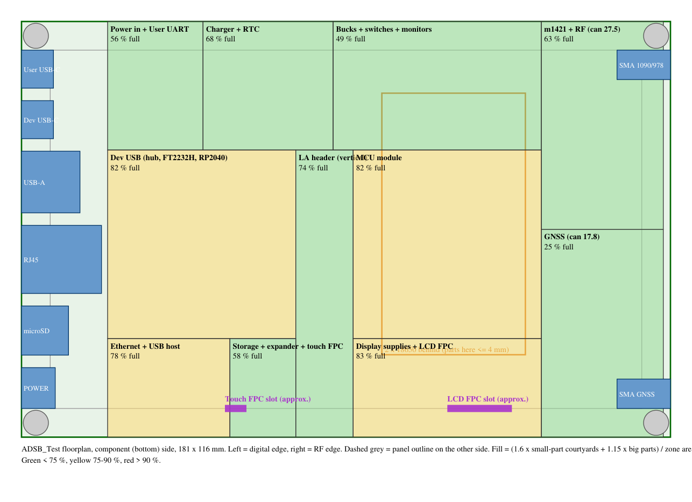

# ADSB_Test block floorplan (fit check, 2026-10-12)

A quick check, before layout, that every block still fits now the MCU is the
WT01P4C5-S1 module, the Dev port has the hub + FT2232H + RP2040, and the RF cans,
RTC, test pads and LA header are in. It is **not** a placement: it sizes zones
from the real footprints and checks them against the board, the edge
connectors, the mounting holes, the panel cables and the battery.

Re-run after schematic changes:

```powershell
python boards\adsb-test\hardware\floorplan\floorplan.py --compare        # gap 4..16 mm round the panel
python boards\adsb-test\hardware\floorplan\floorplan.py                  # 180.9 x 116 mm: table + floorplan.svg/png
python boards\adsb-test\hardware\floorplan\floorplan.py --size 196x97    # any other size
```



_Component (bottom) side; the panel is on the other side. Left = digital
edge, right = RF edge. Orange box = where the 2 × 18650 cells sit behind the
board (parts there ≤ 4 mm). Purple = slots for the panel cables (Waveshare
panel positions, approximate). Grey circles = corner mounting holes._

## Method

- Courtyard of every placed part from its KiCad footprint (480 parts,
  including the 1.5 mm test pads): **about 11,000 mm²**.
- Required zone area = 1.6 × small parts (spacing and 4-layer routing for hand
  assembly) + 1.15 × big parts (module, connectors, cans). RF can frames count as
  an envelope for the parts under them.
- Green < 75 %, yellow 75–90 %, red > 90 % of the zone. Above about 90 % hand
  assembly gets uncomfortable.

## Board outline: panel + an even gap all round

The panel is 164.9 × 100 mm (the AliExpress MIPI panel drawing; the Waveshare
lens is 164.28 × 99.17). Making the board bigger than the panel on **all four
sides** gives an even border in the case. The panel cables then fold through
**slots in the PCB** at the panel's bottom edge instead of round the board edge.

| Gap round the panel | Board | Overall | Fullest zone |
|---------------------|-------|---------|--------------|
| 4 mm | 172.9 × 108 | 75 % | 96 % (too tight) |
| 6 mm | 176.9 × 112 | 70 % | 89 % (borderline) |
| **8 mm** | **180.9 × 116** | **66 %** | **83 %** |
| 10 mm | 184.9 × 120 | 62 % | 77 % |
| 12 mm | 188.9 × 124 | 59 % | 72 % |

For comparison, the earlier plan (188 × 97, the panel flush with the long edges)
is 75 % overall but 100 % along the display strip.

**Recommended: 8 mm gap, board 180.9 × 116 mm** (Q28). Zones:

| Zone | Size (mm) | Fill |
|------|-----------|------|
| Power in + User UART | 27 × 36 | 56 % |
| Charger + RTC | 36 × 36 | 68 % |
| Bucks + load switches + monitors | 58 × 36 | 49 % |
| m1421 + RF (can 27.5 mm) | 34 × 58 | 63 % |
| GNSS (can 17.8 mm) | 34 × 58 | 25 % (keep it quiet) |
| Dev USB (hub, FT2232H, RP2040) | 52 × 53 | 82 % |
| LA header (vertical) | 16 × 80 | 74 % |
| MCU module | 52 × 53 | 82 % |
| Ethernet + USB host | 34 × 28 | 78 % |
| Storage + expander + touch FPC | 18 × 28 | 58 % |
| Display supplies + LCD FPC | 52 × 28 | 83 % |

## Findings

1. **Board 180.9 × 116 mm**, panel centred with an 8 mm border. Shorter than the
   earlier 188 mm, 19 mm taller.
2. **Panel cable slots:** the LCD (30-pin) and touch (6-pin) cables pass through
   slots at the panel's bottom edge. Position them from a measured Waveshare
   board (or the panel that is finally used); the display supplies + 30-pin
   connector sit next to the LCD slot, next to the MCU (short MIPI run), and the
   6-pin touch connector next to its slot in the storage zone.
3. **Mounting holes move to the board corners** (4 mm in). The Waveshare
   156 × 89 mm pattern would now be under the panel.
4. **Digital edge:** User USB-C, Dev USB-C, USB-A, RJ45, microSD **and the POWER
   switch** need 82.5 mm of the 101 mm between the corner holes. All user
   connectors and the switch are on one edge again.
5. **RF edge:** only the two SMAs, far apart (GNSS and 1090/978).
6. **LA header** (2 × 20 shrouded, 59.5 × 10.9 mm, 9.1 mm tall) stands vertically
   between the Dev USB and MCU zones, reachable with the back cover off.
7. **Battery:** two 18650 cells across the board over the MCU and power area.
   Tall parts stay out from under them: RJ45 (13.5 mm, at the edge), JST battery
   connector (9.8 mm), LA header (9.1 mm), USB-A (7 mm), the 150 µF electrolytic
   (6 mm), the RF cans (5.1 mm). The BOOT/RESET buttons (B3F-1000, 4.3 mm) are in
   the MCU zone: use low-profile tactile switches or place them at the zone edge.
8. **RJ45:** the BOM's HR911105A is full-height (13.5 mm), not mid-mount. Fine as
   long as the battery isn't over it.
9. **GNSS corner** has room to spare (25 %): good for noise, and the place to move
   quiet, low-speed parts if something has to give later.
